<p align="center">
  <a href="https://einspommes.github.io"></a>
</p>


```yaml
name:      Jannik / ヤニク  (aka Mika / ミカ)
location:  Germany
doing:     Development & (un)professional Pentesting
systems:   GNU/Linux, FreeBSD, other Unix-likes
languages: Python, Go, C++, JavaScript, Lua, PHP
hardware:  ESP32, RP2040, Flipper Zero, CAN bus, PCB design
```

> Most of my current work is private for security or NDA reasons. More public projects will show up over time.


**[ArithOS](https://github.com/EinsPommes/ArithOS)** ↗<br/>
A stealth pentesting toolkit disguised as a calculator for PicoCalc hardware (RP2040).

**[tesla-can-decoder](https://github.com/EinsPommes/tesla-can-decoder)** ↗<br/>
Turns raw CAN frames into human-readable signals like speed, battery voltage or current.

**[blocklist-scrubber](https://github.com/EinsPommes/blocklist-scrubber)** ↗<br/>
CLI tool to clean & validate blocklists: extract domains, check DNS/HTTP, drop dead entries.

**[SentinelX](https://github.com/EinsPommes/SentinelX-FiveM-AntiCheat)** ↗<br/>
An anti-cheat system for FiveM servers that protects legit players from cheats and exploits.

<br clear="right"/>


<picture>
  <source media="(prefers-color-scheme: dark)" srcset="https://raw.githubusercontent.com/EinsPommes/EinsPommes/output/pacman-contribution-graph-dark.svg">
  <source media="(prefers-color-scheme: light)" srcset="https://raw.githubusercontent.com/EinsPommes/EinsPommes/output/pacman-contribution-graph.svg">
  
</picture>

<p align="center">
  <a href="https://einspommes.github.io">website</a> ·
  <a href="https://github.com/EinsPommes?tab=repositories">all repositories</a>
  <br/>
  <sub>“Break it, understand it, make it better.” · stay curious · hack responsibly</sub>
</p>
