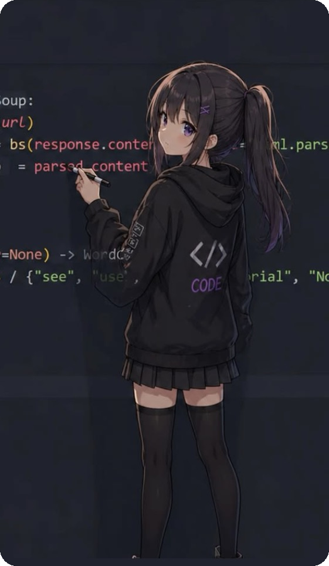
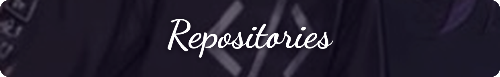
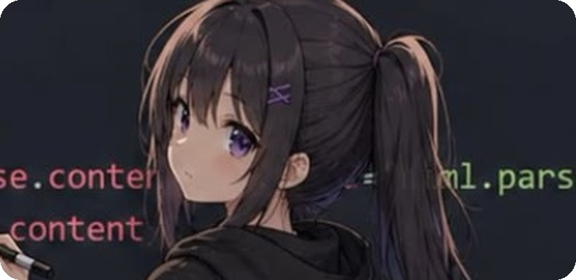

 

 
 

- Name: **Jannik** / **ヤニク** (aka **Mika** / **ミカ**).

- Location: **Germany**.

- Doing: **Development** and **(un)professional Pentesting**.

- System: **GNU/Linux**, **FreeBSD**, and other **Unix-like** systems.

- Languages: **Python**, **Go**, **C++**, **JavaScript**, **Lua** and **PHP**.

- Hardware: **ESP32**, **RP2040**, **Flipper Zero**, **CAN bus** and **PCB design**.

- Note: most of my work is **private** (security / NDA), more public stuff is coming.

 
 

 
 

- 💜 [***EinsPommes/ArithOS***](https://github.com/EinsPommes/ArithOS)  
  A stealth pentesting toolkit disguised as a calculator for PicoCalc hardware (RP2040).
- 🩷 [***EinsPommes/tesla-can-decoder***](https://github.com/EinsPommes/tesla-can-decoder)  
  Turns raw CAN frames into human-readable signals like speed, battery voltage or current.
- 💙 [***EinsPommes/blocklist-scrubber***](https://github.com/EinsPommes/blocklist-scrubber)  
  CLI tool to clean & validate blocklists: extract domains, check DNS/HTTP, drop dead entries.
- 🤍 [***EinsPommes/SentinelX-FiveM-AntiCheat***](https://github.com/EinsPommes/SentinelX-FiveM-AntiCheat)  
  An anti-cheat system for FiveM servers that protects legit players from cheats and exploits.

 
 
“Break it, understand it, make it better.” – Mika&nbsp;&nbsp;&nbsp;&nbsp;&nbsp;&nbsp;&nbsp;&nbsp;&nbsp;&nbsp;&nbsp;&nbsp;&nbsp;&nbsp;&nbsp;&nbsp;&nbsp;&nbsp;&nbsp;&nbsp;&nbsp;&nbsp;&nbsp;&nbsp;&nbsp;&nbsp;&nbsp;&nbsp;&nbsp;&nbsp;&nbsp;&nbsp;&nbsp;&nbsp;&nbsp;&nbsp;&nbsp;&nbsp;&nbsp;&nbsp;stay curious · hack responsibly
  

    

 
 

<picture>
  <source media="(prefers-color-scheme: dark)" srcset="https://raw.githubusercontent.com/EinsPommes/EinsPommes/output/pacman-contribution-graph-dark.svg">
  <source media="(prefers-color-scheme: light)" srcset="https://raw.githubusercontent.com/EinsPommes/EinsPommes/output/pacman-contribution-graph.svg">
  
</picture>

