<div align="center">



<br/>


### こんにちは! I'm **Jannik** <sub>(aka Mika · ミカ)</sub>

**Developer** &nbsp;·&nbsp; **(un)professional Pentester** &nbsp;·&nbsp; **InfoSec enthusiast**


</div>


```yaml
name:      Jannik
alias:     Mika / EinsPommes
role:      Developer & Pentester
interests: [information security, systems, hardware, a certain block-based game]
os:        [GNU/Linux, FreeBSD]
motto:     "Break it, understand it, make it better."
```

> [!NOTE]
> Most of my current work is **private** for security or NDA reasons.
> More public projects will show up here over time — you may have seen me around in various random projects already.


<table>
  <tr>
    <td width="33%" valign="top">
      <h4>🛡️ Offensive Security</h4>
      Pentesting, finding weak spots before others do and writing them up so they actually get fixed.
    </td>
    <td width="33%" valign="top">
      <h4>💻 Development</h4>
      Tools, automation and backends — from quick scripts to software that has to run reliably.
    </td>
    <td width="33%" valign="top">
      <h4>🔧 Systems & Hardware</h4>
      Linux administration, networking, embedded devices and the occasional PCB.
    </td>
  </tr>
</table>


<div align="center">

**Languages**<br/>


**Systems & Tools**<br/>


**Hardware**<br/>


</div>



<div align="center">

<picture>
  <source media="(prefers-color-scheme: dark)" srcset="https://raw.githubusercontent.com/EinsPommes/EinsPommes/output/pacman-contribution-graph-dark.svg">
  <source media="(prefers-color-scheme: light)" srcset="https://raw.githubusercontent.com/EinsPommes/EinsPommes/output/pacman-contribution-graph.svg">
  
</picture>

<br/><br/>


</div>


<div align="center">

<a href="https://github.com/EinsPommes"></a>

<sub>Found a security issue in one of my projects? Please reach out privately before disclosing it publicly. ありがとう!</sub>

<br/><br/>


<sub>All artwork in this profile is original and drawn as SVG.</sub>

</div>
